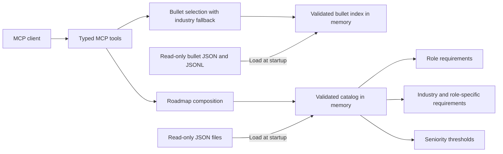

# Roadmap MCP

A file-backed MCP server that returns skills roadmaps and resume bullet baselines for a role,
industry, and seniority level.

```json
{
  "role_name": "Backend Engineer",
  "industry": "Fintech",
  "seniority_level": "Senior",
  "include_descriptions": true
}
```

The response separates relevant hard and soft skills, preserving named categories within each section. By default, each skill contains only its exact name and a short description:

```json
{
  "hard_skills": [
    {
      "name": "Programming Languages",
      "skills": [
        {
          "name": "Python",
          "description": "Write applications and automation using Python modules, collections, exceptions, and asynchronous code."
        }
      ]
    },
    {
      "name": "Databases & Caching",
      "skills": [
        {
          "name": "PostgreSQL",
          "description": "Build relational applications using PostgreSQL schemas, constraints, indexes, and transactions."
        },
        {
          "name": "Redis",
          "description": "Use Redis data structures for caching, counters, expiration, and atomic operations."
        }
      ]
    }
  ],
  "soft_skills": [
    {
      "name": "Technical Leadership",
      "skills": [
        {
          "name": "Technical leadership",
          "description": "Lead technical reviews, mentor engineers, and coordinate delivery decisions."
        }
      ]
    }
  ]
}
```

This is an excerpt; the full result includes every matching skill, grouped once under its assigned category and type. Both `hard_skills` and `soft_skills` are always present. A section without matching skills is `[]`; empty categories are omitted. Use skills supported by your experience when writing a resume.

`include_descriptions` is an optional boolean that defaults to `true`. Set it to `false` to omit the `description` field entirely from every skill in both sections. Skill selection, categories, and ordering stay the same. For example, this request:

```json
{
  "role_name": "Backend Engineer",
  "industry": "Fintech",
  "seniority_level": "Senior",
  "include_descriptions": false
}
```

returns records in this form (excerpt):

```json
{
  "hard_skills": [
    {
      "name": "Programming Languages",
      "skills": [{"name": "Python"}, {"name": "Java"}]
    }
  ],
  "soft_skills": [
    {
      "name": "Technical Leadership",
      "skills": [{"name": "Technical leadership"}]
    }
  ]
}
```

Descriptions remain required in the stored source data regardless of this response option.

The catalog contains **617 reusable skills** in **39 categories**, including **171 individually named technologies** in [`data/skills/technologies.json`](data/skills/technologies.json) and **201 industry skills** in [`data/skills/industries.json`](data/skills/industries.json). The classification is **608 hard skills** across 37 categories and **9 soft skills** in Technical Leadership and People and Collaboration. Category names, types, order, and skill assignments live in [`data/categories.json`](data/categories.json).

All **20 roles × 15 industries × 4 seniority levels = 1,200 combinations** are supported through explicit source mappings. Levels are Junior, Mid-level, Senior, and Staff; they express increasing scope within each role, while actual job-title conventions vary. `list_catalog` returns the full names, accepted aliases, and supported coverage.

The response shape has changed from `categories` to `hard_skills` and `soft_skills`; clients should read `hard_skills[*].skills` and `soft_skills[*].skills`.

Hard skills include technologies, learned methods, and industry knowledge, including system design, technical documentation, statistical analysis, user research, budget planning, and payment workflows. Soft skills cover leadership, listening, communication, collaboration, mentoring, delegation, and conflict resolution. Use hard skills as candidates for a resume's Skills section and soft skills to inform evidence-based experience bullets. Seniority filtering applies to both sections. Engineering profiles generally introduce leadership at Senior; design and management profiles include interpersonal skills at earlier levels where relevant. A section without eligible entries remains `[]`.

## Resume bullet baselines

Call `get_bullets` with a role and optional filters. Only `role_name` is required:

```json
{"role_name": "Backend Engineer"}
```

`industry` defaults to all industries. `seniority_level` defaults to `junior` and acts as a
minimum: Junior includes every level; Mid-level includes Mid-level, Senior, and Staff; Senior
includes Senior and Staff; Staff includes Staff. Both fields can also be `null`, which uses
their defaults. `count` defaults to 5 and accepts integers from 1 to 100.

For example, prefer Fintech and select Senior or Staff bullets:

```json
{
  "role_name": "Backend Engineer",
  "industry": "Fintech",
  "seniority_level": "Senior",
  "count": 5
}
```

The response includes resolved `role`, `industry`, and `seniority_level` entries (IDs, names,
and aliases), `requested_count`, `returned_count`, `available_count`, and `bullets`. `industry`
is `null` when no industry was requested; `seniority_level` identifies the minimum level. For this
request the resolved IDs are `backend-engineer`, `fintech-payments`, and `senior`; the requested
count is 5, available count is 180, and returned count is 5. All five bullets match Fintech
at Senior or above. One returned bullet is:

```json
{
  "id": "rib_3d7ae3a8067d",
  "role_id": "backend-engineer",
  "industry_id": "fintech-payments",
  "bullet": "Designed asynchronous processing for webhook and settlement events with idempotent handlers and failure recovery.",
  "focus": "distributed systems",
  "seniority": "senior",
  "evidence_to_request": ["queue design", "failure tests"]
}
```

This is the complete bullet record format. The datasource and response contain only these seven
fields: `id`, `role_id`, `industry_id`, `seniority`, `focus`, `bullet`, and `evidence_to_request`.

The version 2.0.0 seed contains **6,120 editorial examples: 17 roles × 20 industries × 18 bullets**.
Each role/industry pair has four Junior, five Mid-level, five Senior, and four Staff examples.
`count` is an integer from 1 to 100, defaults to 5, and limits the number returned. Selection
matches the role exactly, includes seniority at or above the minimum, and prioritizes a requested
industry. If there are fewer
unique industry matches than requested, it fills the shortfall from other industries for that
role at or above the minimum seniority. With industry omitted, select from all industries in
datasource order. Bullet text is deduplicated ignoring case and extra whitespace; the requested
industry's copy takes priority. Datasource order is preserved within the industry matches and
then within the fallback matches. Each bullet keeps its original `industry_id`.

`available_count` reports the total unique pool for the role at or above the minimum seniority
across all industries, independent of the requested count. Return fewer than requested only when
that pool is exhausted.
A known industry with no direct matches can still return fallback bullets. If no bullets exist
for the role at or above the minimum seniority in any industry, return `bullets: []` and zero
available/returned counts. Unknown dimensions return an error.

Call **`get_bullets_text`** for the same selection as readable plain text, using identical
arguments and defaults:

```python
result = await client.call_tool(
    "get_bullets_text",
    {
        "role_name": "Backend Engineer",
        "industry": "Fintech",
        "seniority_level": "Senior",
        "count": 5,
    },
)
print(result.content[0].text)
```

The response is MCP text content with a title, counts, numbered bullets, seniority, fallback
industry labels, and evidence prompts. It uses the same formatter as `tests/test_bullets_tool.py`.
It has no JSON wrapper or structured content. `get_bullets` continues to return structured JSON.

Use `list_bullet_catalog` to discover the bullet taxonomy, accepted aliases, role/industry coverage,
and total count. Its 17-role/20-industry taxonomy differs from
the 20-role/15-industry skills catalog. Reference IDs remain canonical; explicit aliases support
familiar inputs such as `Fintech`, `SaaS`, `Full Stack Engineer`, and `AI Engineer`. The separate
QA Analyst, QA Automation Engineer, and SDET roles remain distinct; the ambiguous `QA Engineer`
input is unsupported for bullets.

These examples are prompts for collecting evidence and tailoring a resume. They do not establish
that a candidate performed the work. Verify `evidence_to_request` against the person's experience
before using a bullet.

The runtime datasource lives in [`data/bullets/`](data/bullets/):

- `catalog.json`: role, industry, and seniority names, IDs, and aliases.
- `bullets.jsonl`: baseline IDs, filtering dimensions, focus, text, and evidence prompts.
- `manifest.json`: dataset name, version, dimension counts, seniority IDs, and bullet count.

Rebuild it from [`reference/bullets.jsonl`](reference/bullets.jsonl) with:

```bash
uv run python scripts/import_bullets.py
uv run roadmap-mcp validate
```

The importer accepts `--reference-dir` and `--data-dir`, validates a complete staged import before
replacing runtime files, and produces deterministic output. It projects only the seven bullet
fields above into the runtime datasource and removes the obsolete runtime `sources.json` file.
It uses `bullets.jsonl` as the authoritative seed. A JSONL-only update reuses the existing runtime
taxonomy and manifest version and recalculates counts. Rich uploads can supply `dataset_version`;
optional reference taxonomy and manifest files are also supported. The server loads only `data/bullets/`,
so the attachments are not needed at runtime. Both `serve` and `validate` validate this datasource
alongside the skills catalog. The existing Docker data copy and Compose mount include it;
restart the server after updating data.

## Skill coverage

Role profiles live in [`data/roles/`](data/roles/):

| Area | Supported roles |
| --- | --- |
| Web development | Backend Engineer, Frontend Engineer, Full Stack Engineer |
| Infrastructure | DevOps Engineer, Site Reliability Engineer, Cloud Engineer, Platform Engineer |
| Quality and security | QA Engineer, Cybersecurity Engineer |
| Mobile | Android Developer, iOS Developer, Mobile Engineer |
| Data and AI | Data Engineer, Data Analyst, Data Scientist, Machine Learning Engineer, AI Engineer |
| Design and management | UX Designer, Product Manager, Engineering Manager |

| Area | Included topics |
| --- | --- |
| Shared technologies | Git, Linux, Docker, Docker Compose, SSL/TLS, Kubernetes, Terraform, Prometheus, and Datadog |
| Backend | Python, Java, Go, C#, Node.js, Spring Boot, FastAPI, Django, Express.js, PostgreSQL, MySQL, Redis, Apache Kafka, RabbitMQ, GraphQL, and gRPC |
| Frontend | HTML, CSS, JavaScript, TypeScript, React, Vue.js, Angular, Svelte, Next.js, Vite, Tailwind CSS, Jest, Vitest, Playwright, and Cypress |
| Data engineering | Python, SQL, Pandas, NumPy, Apache Airflow, dbt, Apache Spark, Snowflake, Google BigQuery, Amazon Redshift, S3, and Databricks Delta Lake |
| Cloud and operations | AWS, Azure, Google Cloud, Ansible, Pulumi, GitHub Actions, GitLab CI, Jenkins, Helm, ArgoCD, Grafana, OpenTelemetry, Jaeger, and Vault |
| Android | Kotlin, Java, Jetpack Compose, Android Studio, Gradle, Room Database, WorkManager, Hilt, Retrofit, OkHttp, and Coroutines |
| iOS and cross-platform mobile | Swift, SwiftUI, UIKit, Xcode, XCTest, Core Data, Combine, React Native, Flutter, Dart, Expo, Firebase, and Fastlane |
| Quality assurance | Postman, Selenium, Appium, TestRail, JMeter, k6, Locust, test design, exploratory testing, and automation architecture |
| Analytics and machine learning | Excel, Power BI, Tableau, R, Matplotlib, Seaborn, Scikit-learn, PyTorch, TensorFlow, Keras, model evaluation, serving, and monitoring |
| AI engineering | Hugging Face, LangChain, Llama Index, Pinecone, Qdrant, Chroma, FAISS, retrieval-augmented generation, tool calling, and model evaluation |
| Security | Wireshark, NMAP, Tcpdump, Splunk, identity security, vulnerability management, incident response, and security architecture |
| Design, product, and management | Figma, Sketch, Balsamiq, Jira, Linear, Amplitude, Mixpanel, user research, roadmapping, engineering metrics, and budget planning |

Industry mappings live in [`data/industries/`](data/industries/). Shared requirements cover domain fundamentals; role-specific requirements select implementation, interfaces, pipelines, analysis, modeling, AI, operations, security, testing, design, product, or management skills as appropriate.

| Industry | Example domain skills and standards |
| --- | --- |
| Fintech | Stripe API, 3D Secure, payment lifecycles, ledger modeling, reconciliation, settlement, financial reporting, and fraud data |
| Healthcare | HL7 FHIR, SMART on FHIR, patient identity, clinical terminology, consent, access controls, de-identification, and provenance |
| E-commerce | Shopify Storefront API, Shopify GraphQL Admin API, catalog search, carts, orders, inventory, fulfillment, and commerce analytics |
| SaaS | Tenant modeling, subscriptions, entitlements, tenant isolation, recurring revenue, churn, and usage analysis |
| Education | Learning Tools Interoperability (LTI), enrollments, assessments, learner interfaces, learning analytics, and student data protection |
| Banking | ISO 20022, account lifecycles, transaction posting, loan servicing, credit portfolios, and balance invariant testing |
| Insurance | Underwriting, policy lifecycles, claims, coverage rules, loss analytics, and insurance risk modeling |
| Telecommunications | TM Forum Open APIs, service provisioning, usage charging, call detail records, and network anomaly detection |
| Media and Entertainment | HTTP Live Streaming (HLS), transcoding, rights, player interfaces, audience analytics, and content recommendations |
| Gaming | Matchmaking, session reliability, virtual economies, player interfaces, telemetry, abuse prevention, and multiplayer testing |
| Logistics and Supply Chain | Shipment tracking, warehouse allocation, dispatch interfaces, carrier events, route optimization, and delivery analytics |
| Manufacturing | OPC UA, production integration, lot traceability, industrial telemetry, predictive maintenance, and operational technology security |
| Energy and Utilities | Metering, asset integration, interval data, demand forecasting, energy analytics, and service reliability |
| Real Estate | RESO Web API, geospatial search, listings, leases, valuation, and property data pipelines |
| Government and Public Sector | DCAT, case management, public data publication, accessible services, eligibility testing, and service analytics |

For example, Senior Backend Engineer in Fintech selects 116 hard skills across 13 categories and one soft skill in Technical Leadership. Other profiles have distinct content: UX Designer in Healthcare includes Figma and accessible healthcare workflows; Data Analyst in Insurance includes Power BI and loss analytics; QA Engineer in Banking includes Postman and balance invariant testing. Native mobile commerce profiles omit browser-specific performance and SEO skills. Categories preserve source order and skills preserve selection order within each category.

These are candidate skills for resume selection. Languages, frameworks, and cloud products can represent alternative technology stacks; select the ones supported by actual experience. The role, industry, and seniority inputs determine relevance and level eligibility.

Topic coverage is informed by roadmap.sh's [Backend](https://roadmap.sh/backend), [Frontend](https://roadmap.sh/frontend), and [Data Engineer](https://roadmap.sh/data-engineer) roadmaps, with its [API Design](https://roadmap.sh/api-design), [System Design](https://roadmap.sh/system-design), [SQL](https://roadmap.sh/sql), [Docker](https://roadmap.sh/docker), and [Design System](https://roadmap.sh/design-system) roadmaps as additional references. The [official topic repository](https://github.com/nilbuild/developer-roadmap/tree/master/roadmaps) was used to review the interactive roadmap topics.

Technology names use roadmap.sh topic headings and roadmap titles, including its [Node.js](https://roadmap.sh/nodejs), [Spring Boot](https://roadmap.sh/spring-boot), [TypeScript](https://roadmap.sh/typescript), and [Python for Data Analysis](https://roadmap.sh/python-data-analysis) roadmaps. Descriptions are written independently for this catalog.

Expanded role coverage also references roadmap.sh's [Full Stack](https://roadmap.sh/full-stack), [DevOps](https://roadmap.sh/devops), [Cloud Computing](https://roadmap.sh/cloud-computing), [Kubernetes](https://roadmap.sh/kubernetes), [Android](https://roadmap.sh/android), [iOS](https://roadmap.sh/ios), [React Native](https://roadmap.sh/react-native), [Flutter](https://roadmap.sh/flutter), [QA](https://roadmap.sh/qa), [Cyber Security](https://roadmap.sh/cyber-security), [Data Analyst](https://roadmap.sh/data-analyst), [AI and Data Scientist](https://roadmap.sh/ai-data-scientist), [Machine Learning](https://roadmap.sh/machine-learning), [AI Engineer](https://roadmap.sh/ai-engineer), [UX Design](https://roadmap.sh/ux-design), [Product Manager](https://roadmap.sh/product-manager), and [Engineering Manager](https://roadmap.sh/engineering-manager) roadmaps. Site Reliability Engineer and Platform Engineer profiles combine relevant operations, reliability, cloud, and Kubernetes topics.

Industry topics also draw on [Stripe payment events](https://docs.stripe.com/webhooks), [disputes](https://docs.stripe.com/disputes), and [3D Secure](https://docs.stripe.com/payments/3d-secure); [HL7 FHIR](https://www.hl7.org/fhir/overview.html), its [security guidance](https://www.hl7.org/fhir/security.html), and [SMART App Launch](https://hl7.org/fhir/smart-app-launch/); and [Shopify inventory workflows](https://shopify.dev/docs/apps/build/inventory-management-apps/manage-quantities-states) and its [Storefront API](https://shopify.dev/docs/api/storefront). Seniority thresholds and industry assignments are editorial choices for this project, not classifications supplied by roadmap.sh.

Additional domain references include [Stripe subscriptions](https://docs.stripe.com/billing/subscriptions/overview), [1EdTech LTI](https://www.1edtech.org/standards/lti), [ISO 20022](https://www.iso20022.org/), [TM Forum Open APIs](https://www.tmforum.org/oda/open-apis/), [Apple HLS](https://developer.apple.com/streaming/), [OPC UA](https://opcfoundation.org/about/opc-technologies/opc-ua/), [EIA energy data](https://www.eia.gov/opendata/), [RESO Web API](https://www.reso.org/reso-web-api/), and [W3C DCAT](https://www.w3.org/TR/vocab-dcat-3/). Domain descriptions and role assignments are authored for this catalog; these references do not prescribe every role's requirements.

## Architecture

Python 3.12+, the official MCP Python SDK, Pydantic validation, and JSON/JSONL files. The server makes no runtime LLM calls, external requests, or database connections.



A roadmap combines role skills, shared industry skills, and role-specific industry skills. Seniority filters skills by their minimum level. Requirements are cumulative: Senior includes skills listed for Junior, Mid-level, and Senior. Duplicate skills appear once. The catalog's category type determines the hard or soft section; category order follows the source file within each section, and skills preserve their selection order within each category.

This avoids maintaining a separate complete roadmap for every role × industry × level. Exact names and explicit aliases resolve to canonical IDs. Unknown inputs and uncovered combinations return actionable errors. There is no fuzzy substitution or generic fallback.

Streamable HTTP at `/mcp` is the Docker transport; stdio is available for local clients. This follows the [official SDK transport guidance](https://py.sdk.modelcontextprotocol.io/run/). JSON tools expose typed structured content and an output schema; `get_bullets_text` returns plain text content.

```text
data/
  seniority.json                  # Ordered levels and accepted input names
  categories.json                 # Category names, hard/soft types, order, and skill IDs
  skills/technologies.json         # Literal technology names and short descriptions
  skills/*.json                   # Additional technical and industry skills
  roles/*.json                    # Role requirements and minimum seniority
  industries/*.json               # Shared and role-specific industry requirements
  bullets/                        # Baselines, taxonomy, and manifest
src/roadmap_mcp/
  models.py                       # Authoring and response schemas
  catalog.py                      # File loading, indexing, reference validation
  service.py                      # Deterministic composition
  bullet_models.py                # Baseline data and response schemas
  bullets.py                      # Bullet validation, industry priority, fallback, deduplication
  bullet_text.py                  # Shared readable formatting for the MCP tool and local client
  server.py                       # MCP tools and health endpoint
  __main__.py                     # Serve and validate commands
tests/                            # Composition, invalid data, and MCP integration
scripts/import_bullets.py          # Validated reference-to-runtime data import
Dockerfile
compose.yaml
uv.lock                           # Locked application and development dependencies
```

## Run with Docker

```bash
docker compose up --build -d
docker compose ps
curl http://localhost:8000/health
```

Connect an MCP client to `http://localhost:8000/mcp`. `/mcp` speaks MCP, not a custom REST lookup API. Its tools are:

| Tool | Arguments | Result |
| --- | --- | --- |
| `list_catalog` | None | Names, IDs, aliases, seniority levels, and role/industry coverage |
| `get_roadmap` | `role_name`, `industry`, `seniority_level`; optional `include_descriptions` (default `true`) | Separate `hard_skills` and `soft_skills` lists containing named categories |
| `list_bullet_catalog` | None | Bullet taxonomy, aliases, role/industry coverage, and total count |
| `get_bullets` | `role_name`; optional `industry` (all), `seniority_level` (minimum `junior`), `count` (`5`, range `1`–`100`) | Matching baselines with evidence prompts and available/returned counts |
| `get_bullets_text` | Same as `get_bullets` | The same selection as readable MCP text content |

If port 8000 is occupied, use `ROADMAP_PORT=8001 docker compose up --build -d` and connect to `http://localhost:8001/mcp`. The container continues to listen on port 8000 internally.

Use the executable redeploy script after changing code or source data:

```bash
./redeploy.sh
```

The script builds the image, validates the mounted JSON files, recreates the service, and waits for it to become healthy. A build or validation failure stops the script before recreation. It can be invoked from any directory and uses this repository's Compose configuration. The port comes from `ROADMAP_PORT`, then `.env`, then the existing service's published port, then 8000.

To set the port or health-check timeout explicitly:

```bash
ROADMAP_PORT=8004 ROADMAP_WAIT_TIMEOUT=120 ./redeploy.sh
```

Failed startup prints the container status and recent logs and exits with a nonzero status.

The Compose service mounts `./data` at `/app/data:ro`. Data persists on the host and can change independently of the image. Each process loads one validated snapshot at startup; updates become visible after a restart:

```bash
docker compose run --rm roadmap validate
docker compose restart roadmap
```

The image runs as a non-root user, and Compose uses a read-only root filesystem. `ROADMAP_BIND_ADDRESS` controls the published interface and defaults to `127.0.0.1`. Copy `.env.example` to `.env` to save deployment settings across redeployments.

For direct HTTP access through a public IPv4 address, configure `.env` with the actual public IP:

```dotenv
ROADMAP_BIND_ADDRESS=0.0.0.0
ROADMAP_PORT=8004
ROADMAP_ALLOWED_HOSTS=YOUR_PUBLIC_IP:8004
ROADMAP_ALLOWED_ORIGINS=http://YOUR_PUBLIC_IP:8004
```

Run `./redeploy.sh`, then connect to `http://YOUR_PUBLIC_IP:8004/mcp`. Allow inbound TCP port 8004 in the network firewall. If the host has only private addresses, configure the router to forward public TCP port 8004 to the host's private IP on port 8004. An outbound public IP alone does not establish inbound reachability. Additional access addresses can be added to `ROADMAP_ALLOWED_HOSTS` as a comma-separated list of `IP:port` values. For browser clients, add the application's actual origin to `ROADMAP_ALLOWED_ORIGINS`. Direct HTTP access has no TLS or authentication.

To serve a remote hostname over HTTPS, put the service behind your HTTPS/authentication gateway and set `ROADMAP_ALLOWED_HOSTS` and, for browser clients, `ROADMAP_ALLOWED_ORIGINS`. These configure the SDK's [Host and Origin validation](https://py.sdk.modelcontextprotocol.io/run/deploy/); they do not implement authentication. Rate limiting and public access control belong at that gateway.

```bash
ROADMAP_ALLOWED_HOSTS=mcp.example.com ROADMAP_ALLOWED_ORIGINS=https://app.example.com \
  docker compose up -d
```

The gateway must be able to reach the loopback-published port or share a Docker network with the service. For a shared network, add the hostname the gateway forwards in the Host header to the allowlist. The health endpoint reports `{"status": "ok"}`.

For a Docker stdio client, build the image and launch it with stdin attached, without a TTY:

```bash
docker build -t roadmap-mcp .
docker run --rm -i --no-healthcheck roadmap-mcp serve --transport stdio
```

## Local development

Install [uv](https://docs.astral.sh/uv/), then run commands from this repository root:

```bash
uv sync --frozen
uv run roadmap-mcp validate
uv run roadmap-mcp serve
uv run pytest
uv run ruff check .
uv run ruff format --check .
```

Use `uv run roadmap-mcp serve --transport stdio` for a subprocess client. Use `--data-dir /absolute/path` or `ROADMAP_DATA_DIR` when running outside the repository root. The wheel contains application code; catalog files are supplied separately. The Docker image includes a default catalog.

This SDK client example performs a real MCP call:

```python
import asyncio
import json

from mcp import Client


async def main():
    async with Client("http://localhost:8000/mcp") as client:
        result = await client.call_tool(
            "get_roadmap",
            {
                "role_name": "Backend Engineer",
                "industry": "Fintech",
                "seniority_level": "Senior",
            },
        )
        if result.is_error:
            raise RuntimeError(result.content)
        print(json.dumps(result.structured_content, indent=2))


asyncio.run(main())
```

The Senior Backend Engineer / Fintech result includes APIs, SQL, transactions, distributed systems, privacy, audit trails, payment idempotency, reconciliation, incident response, and technical leadership. Every skill contains `name` and, by default, `description`. Passing `"include_descriptions": false` returns only `name` for each skill.

The readable client example supports both modes:

```bash
uv run python tests/test_tool.py
uv run python tests/test_tool.py --no-descriptions
```

The flag sets `include_descriptions` on the MCP request, so descriptions are omitted by the server.

Test bullet retrieval with the matching readable client script:

```bash
uv run python tests/test_bullets_tool.py
uv run python tests/test_bullets_tool.py --count 1
uv run python tests/test_bullets_tool.py --role "AI Engineer" --industry "SaaS" --seniority "Mid-level"
uv run python tests/test_bullets_tool.py --json
uv run python tests/test_bullets_tool.py --text
uv run python tests/test_bullets_tool.py --text --industry "Fintech" --seniority "Senior"
```

It defaults to the same local server as `test_tool.py` (`http://192.168.6.128:8004/mcp`), with
Backend Engineer / all industries / Junior and above, with a count of 5. Output shows requested,
available, and returned counts, each bullet, and evidence prompts. Fallback bullets display their original
industry ID. Use `--json` for the complete structured response, or `--text` to call the
`get_bullets_text` endpoint directly. The two flags are mutually exclusive.
For a server started with the default local settings:

```bash
uv run roadmap-mcp serve
# In another terminal:
uv run python tests/test_bullets_tool.py --url http://localhost:8000/mcp
```

## Extend the catalog

Skill files store a dictionary keyed by stable skill IDs. Each value always contains exactly `name` and `description`, matching the default full skill response:

```json
{
  "distributed-systems": {
    "name": "Distributed service reliability",
    "description": "Handle partial failures, retries, duplicate messages, and consistency across services."
  }
}
```

Category assignments in `data/categories.json` reference those IDs separately, so skill content stays minimal. Each skill must belong to exactly one category. Every category requires `type`, set to `hard` or `soft`; all its skills share that type. Categories are returned in file order within each section, and skills within each category preserve selection order. Classification is explicit in the data, with no name-based inference or default type.

Example category entry:

```json
{
  "system-design": {
    "name": "System Design and Architecture",
    "type": "hard",
    "skill_ids": ["distributed-systems"]
  }
}
```

Selection rules also reference skill IDs:

Example role requirement:

```json
{
  "skill_id": "distributed-systems",
  "minimum_seniority": "senior"
}
```

1. Add a skill to `data/skills/*.json` with its name and one-sentence description.
2. Assign its ID to exactly one category in `data/categories.json`. Set `type` to `hard` or `soft` when creating a category.
3. Reference its ID in a role's `requirements`, an industry's shared `requirements`, or its `role_requirements` for a particular role.
4. Set `minimum_seniority` where needed; it defaults to `junior`.
5. To support a new role/industry combination, add the role ID to that industry's `role_requirements`. An empty list supports a combination without additional role-specific skills; a missing key means unsupported.
6. Validate the files and restart the service.

The source data contains skill content and the mappings needed for lookup and categorization. Startup rejects extra skill fields, malformed JSON, duplicate keys/IDs, alias collisions, unknown skill/role/level references, duplicate requirements, duplicate seniority ranks, empty or duplicate category names, missing or invalid category types, unknown category skill IDs, skills assigned more than once, and skills without a category.

JSON is the recommended starting point because this workload is read-heavy, small, and benefits from reviewable file changes. An in-memory index handles lookups; requests do not rescan disk. Keep updates outside the request path. If the catalog later needs concurrent authoring, transactional updates, or much larger indexed queries, SQLite is the natural next step while retaining file storage and the current service interface.
