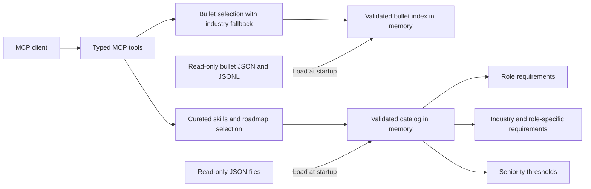

# Roadmap MCP

A file-backed MCP server for curated resume skill discovery and resume bullet baselines.
The [complete non-bullet datasource review](data/REVIEW.md) records coverage, corrections,
and the rationale for current priorities and seniority thresholds.
Use `get_skills` to retrieve technical options for a role. The consuming LLM matches the job
description, verifies candidate experience, removes irrelevant options, and writes the final
resume skills section.

Only the role is required:

```json
{"role_name": "AI Engineer"}
```

`get_skills` returns a compact structured response. For example, calling it with
`{"role_name": "Data Engineer", "seniority_level": "Senior", "limit": 4}` returns:

```json
{
  "role": "Data Engineer",
  "industry": null,
  "seniority": "Senior",
  "categories": [
    "Programming Languages",
    "Data Processing & ETL/ELT",
    "CI/CD & DevOps"
  ],
  "skills": {
    "P0": ["Python", "SQL", "Git", "Batch data ingestion"],
    "P1": [],
    "P2": []
  }
}
```

Categories follow the explicit `response_categories` order in the requested role's data file.
Categories are plain names without skill counts. Categories with no returned skills after
industry/seniority filtering and the response limit are omitted; all three priority groups
are always present. Categories
are available options, not mandatory requirements. Each skill appears once, and names within
each priority retain curated source order.

| Response priority | Source priority | Editorial role-level meaning |
| --- | --- | --- |
| P0 | 1 | Core technology, implementation capability, or professional method |
| P1 | 2 | Supporting option |
| P2 | 3 | Specialized or optional option |

Priorities are stored per role and remain unchanged in the source catalog. They are not
job-description rankings, measured hiring frequency, or evidence of candidate experience.
Industry additions use P2; seniority filters eligibility without reranking role priorities.
The caller matches the JD and verified candidate experience before selecting final resume skills.
Soft skills are excluded from skills discovery.

The technical response taxonomy is:

- Programming Languages
- Web Platform
- Frontend & UI Engineering
- Backend Frameworks & Runtimes
- Mobile Development
- APIs & Service Integration
- Databases & ORMs
- Data Warehouses & Lakehouses
- Data Modeling & Transformation
- Data Processing & ETL/ELT
- Workflow Orchestration
- Streaming & Change Data Capture
- Data Quality & Governance
- BI & Analytics
- Distributed Systems & Messaging
- Cloud & Infrastructure
- CI/CD & DevOps
- Observability & Reliability
- Security & Authentication
- Testing & Quality Engineering
- Architecture & System Design
- Third-Party Integrations
- AI/ML & LLM Engineering

Broad source categories are split where needed: SQL is a programming language; Airflow is
workflow orchestration; dbt is data modeling and transformation; Spark is data processing;
Snowflake is a warehouse; Kafka is streaming; data lineage is governance. Technical role maps
contain relevant categories from the 23-category taxonomy above. UX Designer, Product
Manager, and Engineering Manager also retain their applicable User Experience & Design,
Product Management, and Engineering Management categories. Data Analyst may include Product
Management, and QA Engineer may include Engineering Management for their curated methods.
Industry labels such as Banking,
Healthcare, and E-commerce are not response categories.

Each role in `data/roles/*.json` defines its own ordered category map. All skill selection,
including role options and industry additions, respects that map before the skill limit is
applied. Skills outside the map are omitted instead of introducing legacy or unrelated
categories. Validation requires maps to cover every curated option and direct role/industry
assignment, including professional methods. Applied skills and technologies require a permitted
response-category projection; legacy industry labels cannot silently hide them.
Source category ownership and the compatible `get_roadmap` response shape are unchanged.

Each role also defines `required_categories`: mandatory coverage in its full curated baseline,
independent of industry and across all seniority levels. Startup rejects missing, empty,
duplicate, disallowed, or uncovered required categories. A required category must be in the
role's response map and contain at least one curated option. Seniority filters and smaller
result limits can omit categories; this rule does not assert a candidate must know every
option. Optional contextual categories such as Third-Party Integrations need not be required.

Web fundamentals retain Web Platform, native libraries retain Mobile Development, and shared
component libraries and tokens use Frontend & UI Engineering. Domain modeling uses Data Modeling
& Transformation, client event instrumentation uses BI & Analytics, and financial reconciliation
uses Data Quality & Governance. Stable skill IDs, existing role priorities, and public response
shapes are preserved; clients displaying category names will see the corrected labels.

For example, [Data Engineer](data/roles/data-engineer.json) starts with:

```json
"response_categories": [
  "Programming Languages",
  "Data Processing & ETL/ELT",
  "Data Warehouses & Lakehouses",
  "Data Modeling & Transformation",
  "Workflow Orchestration"
]
```

This excerpt shows the first five entries. Supporting categories follow them in the role file.
Only categories with selected skills appear in a response; seniority, industry, and limit affect
which categories appear without changing their configured order. Reordering the role's map changes category order without
changing skill priorities. Catalog validation rejects missing, empty, duplicate, unknown, or
incomplete maps.

`get_skills` accepts these optional arguments:

| Argument | Default | Behavior |
| --- | --- | --- |
| `industry` | `null` | Add role-specific and shared industry options at P2; preserve existing role priorities. |
| `seniority_level` | `null` | Omitted means all levels; a supplied level includes that level and below. |
| `limit` | `50` | Return at most 1-50 options, sorted by priority and then curated source order. |
| `include_descriptions` | `false` | Accepted for compatibility; the summary always omits descriptions. |

Role options win priority ties over industry additions; role-specific industry additions precede
shared industry additions. Duplicate IDs appear once. Filtering can produce fewer than 30
options; the server does not pad results. Unknown inputs and unsupported combinations return
errors without substituting another role.

For a two-line text response, use `get_skills_text` (default `output_format="compact"`). For
technology types, families, ecosystems, selection groups, and capability links, use
`get_skills_text` with `output_format="detailed"`. Add `include_descriptions=true` for descriptions
in detailed output. Compact text always contains only category names and skill priorities.
Metadata provides selection hints, not mandatory stacks, interchangeable tools, or evidence of
proficiency. Links never add skills or alter priorities.

The source inventory contains **605 reusable skills** in **43 categories**, including
**176 named technologies** in [technologies.json](data/skills/technologies.json) and
**201 industry skills** in [industries.json](data/skills/industries.json). There are 596 hard
skills and 9 soft skills. Each role stores an explicit curated subset in `skill_options`,
alongside the larger cumulative inventory used by the compatibility endpoint. See the
[catalog curation guide](data/README.md) for inclusion rules and source references.

All **20 roles × 15 industries × 4 seniority levels = 1,200 combinations** are supported through
explicit mappings. `list_catalog` returns canonical names, IDs, aliases, and coverage. Levels
are Junior, Mid-level, Senior, and Staff; these are editorial thresholds within each role.

`get_roadmap` remains available for existing clients that need the full cumulative inventory.
It requires role, industry, and seniority and returns `hard_skills` and `soft_skills`, each a list
of named categories. Its skills contain `name` and, by default, `description`;
`include_descriptions=false` returns name only. This legacy response shape is unchanged.
Use `get_skills` for curated options, category names, and baseline priorities; use
`get_skills_text` with `output_format="detailed"` for technology metadata.

## Resume bullet baselines

Call `get_bullets` with a role and optional filters. Only `role_name` is required:

```json
{"role_name": "Backend Engineer"}
```

`industry` defaults to all industries. `seniority_level` defaults to `junior` and acts as a
minimum: Junior includes every level; Mid-level includes Mid-level, Senior, and Staff; Senior
includes Senior and Staff; Staff includes Staff. Both fields can also be `null`, which uses
their defaults. `count` defaults to 5 and accepts integers from 1 to 100.

For example, prefer Fintech and select Senior or Staff bullets:

```json
{
  "role_name": "Backend Engineer",
  "industry": "Fintech",
  "seniority_level": "Senior",
  "count": 5
}
```

The response includes resolved `role`, `industry`, and `seniority_level` entries (IDs, names,
and aliases), `requested_count`, `returned_count`, `available_count`, and `bullets`. `industry`
is `null` when no industry was requested; `seniority_level` identifies the minimum level. For this
request the resolved IDs are `backend-engineer`, `fintech-payments`, and `senior`; the requested
count is 5, available count is 180, and returned count is 5. All five bullets match Fintech
at Senior or above. One returned bullet is:

```json
{
  "id": "rib_3d7ae3a8067d",
  "role_id": "backend-engineer",
  "industry_id": "fintech-payments",
  "bullet": "Designed asynchronous processing for webhook and settlement events with idempotent handlers and failure recovery.",
  "focus": "distributed systems",
  "seniority": "senior",
  "evidence_to_request": ["queue design", "failure tests"]
}
```

This is the complete bullet record format. The datasource and response contain only these seven
fields: `id`, `role_id`, `industry_id`, `seniority`, `focus`, `bullet`, and `evidence_to_request`.

The version 2.0.0 seed contains **6,120 editorial examples: 17 roles × 20 industries × 18 bullets**.
Each role/industry pair has four Junior, five Mid-level, five Senior, and four Staff examples.
`count` is an integer from 1 to 100, defaults to 5, and limits the number returned. Selection
matches the role exactly, includes seniority at or above the minimum, and prioritizes a requested
industry. If there are fewer
unique industry matches than requested, it fills the shortfall from other industries for that
role at or above the minimum seniority. With industry omitted, select from all industries in
datasource order. Bullet text is deduplicated ignoring case and extra whitespace; the requested
industry's copy takes priority. Datasource order is preserved within the industry matches and
then within the fallback matches. Each bullet keeps its original `industry_id`.

`available_count` reports the total unique pool for the role at or above the minimum seniority
across all industries, independent of the requested count. Return fewer than requested only when
that pool is exhausted.
A known industry with no direct matches can still return fallback bullets. If no bullets exist
for the role at or above the minimum seniority in any industry, return `bullets: []` and zero
available/returned counts. Unknown dimensions return an error.

Call **`get_bullets_text`** for the same selection as readable plain text, using identical
arguments and defaults:

```python
result = await client.call_tool(
    "get_bullets_text",
    {
        "role_name": "Backend Engineer",
        "industry": "Fintech",
        "seniority_level": "Senior",
        "count": 5,
    },
)
print(result.content[0].text)
```

The response is MCP text content with a title, counts, numbered bullets, seniority, fallback
industry labels, and evidence prompts. It uses the same formatter as `tests/test_bullets_tool.py`.
It has no JSON wrapper or structured content. `get_bullets` continues to return structured JSON.

Use `list_bullet_catalog` to discover the bullet taxonomy, accepted aliases, role/industry coverage,
and total count. Its 17-role/20-industry taxonomy differs from
the 20-role/15-industry skills catalog. Reference IDs remain canonical; explicit aliases support
familiar inputs such as `Fintech`, `SaaS`, `Full Stack Engineer`, and `AI Engineer`. The separate
QA Analyst, QA Automation Engineer, and SDET roles remain distinct; the ambiguous `QA Engineer`
input is unsupported for bullets.

These examples are prompts for collecting evidence and tailoring a resume. They do not establish
that a candidate performed the work. Verify `evidence_to_request` against the person's experience
before using a bullet.

The runtime datasource lives in [`data/bullets/`](data/bullets/):

- `catalog.json`: role, industry, and seniority names, IDs, and aliases.
- `bullets.jsonl`: baseline IDs, filtering dimensions, focus, text, and evidence prompts.
- `manifest.json`: dataset name, version, dimension counts, seniority IDs, and bullet count.

Rebuild it from [`reference/bullets.jsonl`](reference/bullets.jsonl) with:

```bash
uv run python scripts/import_bullets.py
uv run roadmap-mcp validate
```

The importer accepts `--reference-dir` and `--data-dir`, validates a complete staged import before
replacing runtime files, and produces deterministic output. It projects only the seven bullet
fields above into the runtime datasource and removes the obsolete runtime `sources.json` file.
It uses `bullets.jsonl` as the authoritative seed. A JSONL-only update reuses the existing runtime
taxonomy and manifest version and recalculates counts. Rich uploads can supply `dataset_version`;
optional reference taxonomy and manifest files are also supported. The server loads only `data/bullets/`,
so the attachments are not needed at runtime. Both `serve` and `validate` validate this datasource
alongside the skills catalog. The existing Docker data copy and Compose mount include it;
restart the server after updating data.

## Skill coverage

Role profiles live in [`data/roles/`](data/roles/):

| Area | Supported roles |
| --- | --- |
| Web development | Backend Engineer, Frontend Engineer, Full Stack Engineer |
| Infrastructure | DevOps Engineer, Site Reliability Engineer, Cloud Engineer, Platform Engineer |
| Quality and security | QA Engineer, Cybersecurity Engineer |
| Mobile | Android Developer, iOS Developer, Mobile Engineer |
| Data and AI | Data Engineer, Data Analyst, Data Scientist, Machine Learning Engineer, AI Engineer |
| Design and management | UX Designer, Product Manager, Engineering Manager |

| Area | Included topics |
| --- | --- |
| Shared technologies | Git, Linux, Docker, Docker Compose, TLS, Kubernetes, Terraform, Prometheus, and Datadog |
| Backend | Python, Java, Go, C#, Node.js, Spring Boot, FastAPI, Django, Express.js, PostgreSQL, MySQL, Redis, Apache Kafka, RabbitMQ, GraphQL, and gRPC |
| Frontend | HTML, CSS, JavaScript, TypeScript, React, Vue.js, Angular, Svelte, Next.js, Vite, Tailwind CSS, Jest, Vitest, Playwright, and Cypress |
| Data engineering | Python, SQL, pandas, NumPy, Apache Airflow, dbt, Apache Spark, Snowflake, Google BigQuery, Amazon Redshift, Amazon S3, and Delta Lake |
| Cloud and operations | AWS, Azure, Google Cloud, Ansible, Pulumi, GitHub Actions, GitLab CI, Jenkins, Helm, Argo CD, Grafana, OpenTelemetry, Jaeger, and Vault |
| Android | Kotlin, Java, Jetpack Compose, Android Studio, Gradle, Room, WorkManager, Hilt, Retrofit, OkHttp, and Kotlin Coroutines |
| iOS and cross-platform mobile | Swift, SwiftUI, UIKit, Xcode, XCTest, Core Data, Combine, React Native, Flutter, Dart, Expo, Firebase, and Fastlane |
| Quality assurance | Postman, Selenium, Appium, TestRail, JMeter, k6, Locust, test design, exploratory testing, and automation architecture |
| Analytics and machine learning | Excel, Power BI, Tableau, R, Matplotlib, Seaborn, scikit-learn, PyTorch, TensorFlow, Keras, model evaluation, serving, and monitoring |
| AI engineering | Hugging Face Transformers, LangChain, LangGraph, LlamaIndex, vector stores, RAG, function calling, and LLM evaluation |
| Security | Wireshark, Nmap, tcpdump, Splunk, identity security, vulnerability management, incident response, and security architecture |
| Design, product, and management | Figma, Sketch, Balsamiq, Jira, Linear, Amplitude, Mixpanel, user research, roadmapping, engineering metrics, and budget planning |

Industry mappings live in [`data/industries/`](data/industries/). Shared requirements cover explicit domain models and data-handling practices; role-specific requirements select implementation, interfaces, pipelines, analysis, modeling, AI, operations, security, testing, design, product, or management skills as appropriate.

| Industry | Example domain skills and standards |
| --- | --- |
| Fintech | Stripe API, 3D Secure, payment lifecycles, ledger modeling, reconciliation, settlement, financial reporting, and fraud data |
| Healthcare | HL7 FHIR, SMART on FHIR, patient identity, clinical terminology, consent, access controls, de-identification, and provenance |
| E-commerce | Shopify Storefront API, Shopify GraphQL Admin API, catalog search, carts, orders, inventory, fulfillment, and commerce analytics |
| SaaS | Tenant modeling, subscriptions, entitlements, tenant isolation, recurring revenue, churn, and usage analysis |
| Education | Learning Tools Interoperability (LTI), enrollments, assessments, learner interfaces, learning analytics, and student data protection |
| Banking | ISO 20022, account lifecycles, transaction posting, loan servicing, credit portfolios, and balance invariant testing |
| Insurance | Underwriting, policy lifecycles, claims, coverage rules, loss analytics, and insurance risk modeling |
| Telecommunications | TM Forum Open APIs, service provisioning, usage charging, call detail records, and network anomaly detection |
| Media and Entertainment | HTTP Live Streaming (HLS), transcoding, rights, player interfaces, audience analytics, and content recommendations |
| Gaming | Matchmaking, session reliability, virtual economies, player interfaces, telemetry, abuse prevention, and multiplayer testing |
| Logistics and Supply Chain | Shipment tracking, warehouse allocation, dispatch interfaces, carrier events, route optimization, and delivery analytics |
| Manufacturing | OPC UA, production integration, lot traceability, industrial telemetry, predictive maintenance, and operational technology security |
| Energy and Utilities | Metering, asset integration, interval data, demand forecasting, energy analytics, and service reliability |
| Real Estate | RESO Web API, geospatial search, listings, leases, valuation, and property data pipelines |
| Government and Public Sector | DCAT, case management, public data publication, accessible services, eligibility testing, and service analytics |

For example, the compatibility `get_roadmap` response for Senior Backend Engineer in Fintech selects 110 hard skills across 13 categories and one soft skill in Technical Leadership. Other profiles have distinct content: UX Designer in Healthcare includes Figma and accessible healthcare workflows; Data Analyst in Insurance includes Power BI and loss analytics; QA Engineer in Banking includes Postman and balance invariant testing. Native mobile commerce profiles omit browser-specific performance and SEO skills. Roadmap categories preserve source order and skills preserve selection order within each category. `get_skills` uses the smaller curated role subset and priority order described above.

These are candidate skills for resume selection. Languages, frameworks, and cloud products can represent alternative technology stacks; select the ones supported by actual experience. The role, industry, and seniority inputs determine relevance and level eligibility.

The original topic inventory was informed by roadmap.sh's [Backend](https://roadmap.sh/backend), [Frontend](https://roadmap.sh/frontend), and [Data Engineer](https://roadmap.sh/data-engineer) roadmaps, with its [API Design](https://roadmap.sh/api-design), [System Design](https://roadmap.sh/system-design), [SQL](https://roadmap.sh/sql), [Docker](https://roadmap.sh/docker), and [Design System](https://roadmap.sh/design-system) roadmaps as additional references. The [official topic repository](https://github.com/nilbuild/developer-roadmap/tree/master/roadmaps) was used to review the interactive roadmap topics. The current catalog is editorially curated for implementation experience; it does not mirror every learning-roadmap topic.

Technology names use roadmap.sh topic headings and roadmap titles, including its [Node.js](https://roadmap.sh/nodejs), [Spring Boot](https://roadmap.sh/spring-boot), [TypeScript](https://roadmap.sh/typescript), and [Python for Data Analysis](https://roadmap.sh/python-data-analysis) roadmaps. Descriptions are written independently for this catalog.

Expanded role coverage also references roadmap.sh's [Full Stack](https://roadmap.sh/full-stack), [DevOps](https://roadmap.sh/devops), [Cloud Computing](https://roadmap.sh/cloud-computing), [Kubernetes](https://roadmap.sh/kubernetes), [Android](https://roadmap.sh/android), [iOS](https://roadmap.sh/ios), [React Native](https://roadmap.sh/react-native), [Flutter](https://roadmap.sh/flutter), [QA](https://roadmap.sh/qa), [Cyber Security](https://roadmap.sh/cyber-security), [Data Analyst](https://roadmap.sh/data-analyst), [AI and Data Scientist](https://roadmap.sh/ai-data-scientist), [Machine Learning](https://roadmap.sh/machine-learning), [AI Engineer](https://roadmap.sh/ai-engineer), [UX Design](https://roadmap.sh/ux-design), [Product Manager](https://roadmap.sh/product-manager), and [Engineering Manager](https://roadmap.sh/engineering-manager) roadmaps. Site Reliability Engineer and Platform Engineer profiles combine relevant operations, reliability, cloud, and Kubernetes topics.

Industry topics also draw on [Stripe payment events](https://docs.stripe.com/webhooks), [disputes](https://docs.stripe.com/disputes), and [3D Secure](https://docs.stripe.com/payments/3d-secure); [HL7 FHIR](https://www.hl7.org/fhir/overview.html), its [security guidance](https://www.hl7.org/fhir/security.html), and [SMART App Launch](https://hl7.org/fhir/smart-app-launch/); and [Shopify inventory workflows](https://shopify.dev/docs/apps/build/inventory-management-apps/manage-quantities-states) and its [Storefront API](https://shopify.dev/docs/api/storefront). Seniority thresholds and industry assignments are editorial choices for this project, not classifications supplied by roadmap.sh.

Additional domain references include [Stripe subscriptions](https://docs.stripe.com/billing/subscriptions/overview), [1EdTech LTI](https://www.1edtech.org/standards/lti), [ISO 20022](https://www.iso20022.org/), [TM Forum Open APIs](https://www.tmforum.org/oda/open-apis/), [Apple HLS](https://developer.apple.com/streaming/), [OPC UA](https://opcfoundation.org/about/opc-technologies/opc-ua/), [EIA energy data](https://www.eia.gov/opendata/), [RESO Web API](https://www.reso.org/reso-web-api/), and [W3C DCAT](https://www.w3.org/TR/vocab-dcat-3/). Domain descriptions and role assignments are authored for this catalog; these references do not prescribe every role's requirements.

## Architecture

Python 3.12+, the official MCP Python SDK, Pydantic validation, and JSON/JSONL files. The server makes no runtime LLM calls, external requests, or database connections.



`get_skills` starts from each role's curated `skill_options` and explicit priorities. Optional industry context adds priority-3 options. Filtering and deterministic ordering run against the validated snapshot. The compatibility roadmap combines role skills, shared industry skills, and role-specific industry skills. Seniority filters skills by their minimum level. Requirements are cumulative: Senior includes skills listed for Junior, Mid-level, and Senior. Duplicate skills appear once. The catalog's category type determines the hard or soft section; category order follows the source file within each section, and skills preserve their selection order within each category.

This avoids maintaining a separate complete roadmap for every role × industry × level. Exact names and explicit aliases resolve to canonical IDs. Unknown inputs and uncovered combinations return actionable errors. There is no fuzzy substitution or generic fallback.

Streamable HTTP at `/mcp` is the Docker transport; stdio is available for local clients. This follows the [official SDK transport guidance](https://py.sdk.modelcontextprotocol.io/run/). `get_skills` exposes its compact typed summary and an output schema; other JSON tools expose typed structured content; `get_skills_text` and `get_bullets_text` return plain text content.

```text
data/
  seniority.json                  # Ordered levels and accepted input names
  categories.json                 # Category names, hard/soft types, order, and skill IDs
  skills/technologies.json         # Literal technologies with descriptions and explicit types
  skills/*.json                   # Additional technical and industry skills
  roles/*.json                    # Role category maps, skill options/priorities, and requirements
  industries/*.json               # Shared and role-specific industry requirements
  bullets/                        # Baselines, taxonomy, and manifest
src/roadmap_mcp/
  models.py                       # Authoring and response schemas
  catalog.py                      # File loading, indexing, reference validation
  service.py                      # Deterministic composition
  skills_text.py                  # Shared readable skills formatting for the tool and client
  skill_categories.py             # Technical response taxonomy and skill assignments
  bullet_models.py                # Baseline data and response schemas
  bullets.py                      # Bullet validation, industry priority, fallback, deduplication
  bullet_text.py                  # Shared readable formatting for the MCP tool and local client
  server.py                       # MCP tools and health endpoint
  __main__.py                     # Serve and validate commands
tests/                            # Composition, invalid data, and MCP integration
scripts/import_bullets.py          # Validated reference-to-runtime data import
Dockerfile
compose.yaml
uv.lock                           # Locked application and development dependencies
```

## Run with Docker

```bash
docker compose up --build -d
docker compose ps
curl http://localhost:8000/health
```

Connect an MCP client to `http://localhost:8000/mcp`. `/mcp` speaks MCP, not a custom REST lookup API. Its tools are:

| Tool | Arguments | Result |
| --- | --- | --- |
| `list_catalog` | None | Names, IDs, aliases, seniority levels, and role/industry coverage |
| `get_skills` | `role_name`; optional `industry`, `seniority_level`, `limit` (50), compatibility `include_descriptions` (false) | Role, industry, seniority, category names, and names grouped under P0/P1/P2 |
| `get_skills_text` | Same filters as `get_skills`; optional `include_descriptions` and `output_format` (`compact` or `detailed`, default `compact`) | Two lines of category names and skill priorities, or detailed readable metadata |
| `get_roadmap` | `role_name`, `industry`, `seniority_level`; optional `include_descriptions` (default `true`) | Separate `hard_skills` and `soft_skills` lists containing named categories |
| `list_bullet_catalog` | None | Bullet taxonomy, aliases, role/industry coverage, and total count |
| `get_bullets` | `role_name`; optional `industry` (all), `seniority_level` (minimum `junior`), `count` (`5`, range `1`–`100`) | Matching baselines with evidence prompts and available/returned counts |
| `get_bullets_text` | Same as `get_bullets` | The same selection as readable MCP text content |

If port 8000 is occupied, use `ROADMAP_PORT=8001 docker compose up --build -d` and connect to `http://localhost:8001/mcp`. The container continues to listen on port 8000 internally.

Use the executable redeploy script after changing code or source data:

```bash
./redeploy.sh
```

The script builds the image, validates the mounted JSON files, recreates the service, and waits for it to become healthy. A build or validation failure stops the script before recreation. It can be invoked from any directory and uses this repository's Compose configuration. The port comes from `ROADMAP_PORT`, then `.env`, then the existing service's published port, then 8000.

To set the port or health-check timeout explicitly:

```bash
ROADMAP_PORT=8004 ROADMAP_WAIT_TIMEOUT=120 ./redeploy.sh
```

Failed startup prints the container status and recent logs and exits with a nonzero status.

The Compose service mounts `./data` at `/app/data:ro`. Data persists on the host and can change independently of the image. Each process loads one validated snapshot at startup; updates become visible after a restart:

```bash
docker compose run --rm roadmap validate
docker compose restart roadmap
```

The image runs as a non-root user, and Compose uses a read-only root filesystem. `ROADMAP_BIND_ADDRESS` controls the published interface and defaults to `127.0.0.1`. Copy `.env.example` to `.env` to save deployment settings across redeployments.

For direct HTTP access through a public IPv4 address, configure `.env` with the actual public IP:

```dotenv
ROADMAP_BIND_ADDRESS=0.0.0.0
ROADMAP_PORT=8004
ROADMAP_ALLOWED_HOSTS=YOUR_PUBLIC_IP:8004
ROADMAP_ALLOWED_ORIGINS=http://YOUR_PUBLIC_IP:8004
```

Run `./redeploy.sh`, then connect to `http://YOUR_PUBLIC_IP:8004/mcp`. Allow inbound TCP port 8004 in the network firewall. If the host has only private addresses, configure the router to forward public TCP port 8004 to the host's private IP on port 8004. An outbound public IP alone does not establish inbound reachability. Additional access addresses can be added to `ROADMAP_ALLOWED_HOSTS` as a comma-separated list of `IP:port` values. For browser clients, add the application's actual origin to `ROADMAP_ALLOWED_ORIGINS`. Direct HTTP access has no TLS or authentication.

To serve a remote hostname over HTTPS, put the service behind your HTTPS/authentication gateway and set `ROADMAP_ALLOWED_HOSTS` and, for browser clients, `ROADMAP_ALLOWED_ORIGINS`. These configure the SDK's [Host and Origin validation](https://py.sdk.modelcontextprotocol.io/run/deploy/); they do not implement authentication. Rate limiting and public access control belong at that gateway.

```bash
ROADMAP_ALLOWED_HOSTS=mcp.example.com ROADMAP_ALLOWED_ORIGINS=https://app.example.com \
  docker compose up -d
```

The gateway must be able to reach the loopback-published port or share a Docker network with the service. For a shared network, add the hostname the gateway forwards in the Host header to the allowlist. The health endpoint reports `{"status": "ok"}`.

For a Docker stdio client, build the image and launch it with stdin attached, without a TTY:

```bash
docker build -t roadmap-mcp .
docker run --rm -i --no-healthcheck roadmap-mcp serve --transport stdio
```

## Local development

Install [uv](https://docs.astral.sh/uv/), then run commands from this repository root:

```bash
uv sync --frozen
uv run roadmap-mcp validate
uv run roadmap-mcp serve
uv run pytest
uv run ruff check .
uv run ruff format --check .
```

Use `uv run roadmap-mcp serve --transport stdio` for a subprocess client. Use `--data-dir /absolute/path` or `ROADMAP_DATA_DIR` when running outside the repository root. The wheel contains application code; catalog files are supplied separately. The Docker image includes a default catalog.

This SDK client example performs a real MCP call:

```python
import asyncio
import json

from mcp import Client


async def main():
    async with Client("http://localhost:8000/mcp") as client:
        result = await client.call_tool(
            "get_skills",
            {"role_name": "AI Engineer"},
        )
        if result.is_error:
            raise RuntimeError(result.content)
        print(json.dumps(result.structured_content, indent=2))


asyncio.run(main())
```

The readable skills client calls `get_skills`. It defaults to Backend Engineer at
`http://localhost:8004/mcp`, role options only, with descriptions omitted. Compact output has
exactly two lines: ordered category names, then skill names with P0/P1/P2 priorities.

Use `--json` for the compact structured summary or `--text` to call `get_skills_text` directly.
The flags are mutually exclusive. All modes accept the same role, industry, seniority, and limit
filters. Use `--output-format detailed` to call `get_skills_text` for each skill's type, category,
family, ecosystems, selection hints, and related capability names. `--descriptions` adds
implementation descriptions only in detailed output. JSON and compact summaries omit descriptions.

```bash
uv run python tests/test_tool.py
uv run python tests/test_tool.py --role "Backend Engineer" --industry "Fintech" --seniority "Senior"
uv run python tests/test_tool.py --json --limit 10
uv run python tests/test_tool.py --text
uv run python tests/test_tool.py --output-format detailed --descriptions
uv run python tests/test_tool.py --url http://localhost:8004/mcp
```

Compact output for Data Engineer, Senior, `--limit 4`:

```text
categories: Programming Languages, Data Processing & ETL/ELT, CI/CD & DevOps
skills: (Python:P0), (SQL:P0), (Git:P0), (Batch data ingestion:P0)
```

For model input, call `get_skills` with `{"role_name": "Backend Engineer"}`, or use
`get_skills_text` for the two-line equivalent. Retrieve metadata on demand through
`get_skills_text` with `output_format="detailed"`.

Test bullet retrieval with the matching readable client script:

```bash
uv run python tests/test_bullets_tool.py
uv run python tests/test_bullets_tool.py --count 1
uv run python tests/test_bullets_tool.py --role "AI Engineer" --industry "SaaS" --seniority "Mid-level"
uv run python tests/test_bullets_tool.py --json
uv run python tests/test_bullets_tool.py --text
uv run python tests/test_bullets_tool.py --text --industry "Fintech" --seniority "Senior"
```

The bullet client defaults to `http://192.168.6.128:8004/mcp`, with
Backend Engineer / all industries / Junior and above, with a count of 5. Output shows requested,
available, and returned counts, each bullet, and evidence prompts. Fallback bullets display their original
industry ID. Use `--json` for the complete structured response, or `--text` to call the
`get_bullets_text` endpoint directly. The two flags are mutually exclusive.
For a server started with the default local settings:

```bash
uv run roadmap-mcp serve
# In another terminal:
uv run python tests/test_bullets_tool.py --url http://localhost:8000/mcp
```

## Extend the catalog

Skill files contain dictionaries keyed by stable IDs. Each entry requires a name, implementation
description, and explicit type:

```json
{
  "postgresql": {
    "name": "PostgreSQL",
    "description": "Build relational applications using PostgreSQL schemas, constraints, indexes, and transactions.",
    "type": "database",
    "technology_family": "Relational Databases",
    "selection_group": "Relational Storage",
    "related_capabilities": ["sql-modeling", "database-transactions", "database-indexing"]
  }
}
```

Allowed types are `language`, `framework`, `sdk`, `library`, `database`, `database_extension`,
`infrastructure`, `tool`, `protocol`, `standard`, `implementation_capability`,
`professional_method`, and `soft_skill`. The response layer follows the explicit type:
technologies use `core_technology`, capabilities use `implementation_capability`, and methods
use `professional_method`. Soft skills are available through the compatibility roadmap only.

Every technology requires an explicit `technology_family`, a readable name for its engineering
purpose. Reuse an existing family name where appropriate. Capabilities, methods,
and soft skills omit it or use `null`. The optional `related_capabilities` list defaults to `[]`;
each stored entry must reference a distinct existing skill of type `implementation_capability`
by its stable ID. The response resolves these references to canonical skill names.
Avoid self-references. These links are nonexhaustive context, not prerequisites or automatic
selection rules. Source entries can omit empty metadata; discovery responses always include it.
The optional `selection_group` uses a readable name like `technology_family` and defaults
to `null`. Assign it only to technologies with a useful architecture-position comparison; leave
it absent for capabilities, methods, soft skills, or technologies without a curated hint. Do not
derive it automatically from family or category, or add prerequisites or one-per-group constraints.

Every skill belongs to exactly one category in `data/categories.json`. Its name and hard/soft
classification are explicit data, with no product-name guessing at request time. `soft_skill`
entries must belong to soft categories; all other entries belong to hard categories.

```json
{
  "databases-caching": {
    "name": "Databases & Caching",
    "type": "hard",
    "skill_ids": ["postgresql"]
  }
}
```

Role `requirements` retain seniority thresholds for the full inventory. Role `skill_options`
curate a subset for discovery and assign priorities independently of seniority:

```json
{
  "requirements": [{"skill_id": "postgresql", "minimum_seniority": "mid"}],
  "skill_options": [{"skill_id": "postgresql", "priority": 1}]
}
```

These are excerpts from a role file, which also requires its ID and name. A skill option must
reference a role requirement and cannot reference a soft skill. Priority must be an integer
from 1 to 3, never inferred from seniority or list position. Ties follow `skill_options` order.
Each role supports up to 50 curated options; choose a broad useful set without filling a quota.
The broader `requirements` list can contain additional skills excluded from discovery.

1. Add or refine a skill in `data/skills/*.json`, including its explicit type and technology family
   where applicable; curate capability links from existing implementation-capability IDs and
   add a selection-group hint only where useful.
2. Assign its ID to exactly one appropriately typed category.
   Update `src/roadmap_mcp/skill_categories.py` if its response category differs from that source.
3. Reference the skill in role or industry requirements; `minimum_seniority` defaults to Junior.
4. For role discovery, add it to that role's `skill_options` with an editorial priority.
   Ensure the role's `response_categories` includes its response category in the desired order.
   Define `required_categories` for the role's baseline and cover each with curated options.
   Include an industry's response category in the associated role map when that category is
   relevant to the role. Direct role/industry assignments must fit the map; shared industry
   defaults outside the map remain excluded.
5. To support a role/industry combination, add the role ID to the industry's `role_requirements`.
   An empty list supports a combination without extra contextual skills; a missing key is unsupported.
6. Validate the files and recreate the server when changing code and data together.

Startup rejects unknown types, missing or malformed technology families, malformed selection groups,
families or selection groups on nontechnologies,
unknown, mistyped, duplicate, or self-referencing capability links, incompatible category types,
missing or invalid priorities,
unreferenced or duplicate role options, soft skill options, malformed JSON, duplicate keys/IDs,
alias collisions, invalid references, duplicate requirements and seniority ranks, and missing or
duplicate category assignments. Source authoring now requires `type` and `skill_options`; these
are deliberate data-schema additions. Existing `get_roadmap` clients retain their response schema.

Catalog edits stay outside the request path. Each process loads and validates one snapshot at
startup, then resolves requests in memory. Data-only updates to an already upgraded deployment
need a restart. For this code-and-data upgrade use `./redeploy.sh`, which rebuilds and validates
before recreating the service.
